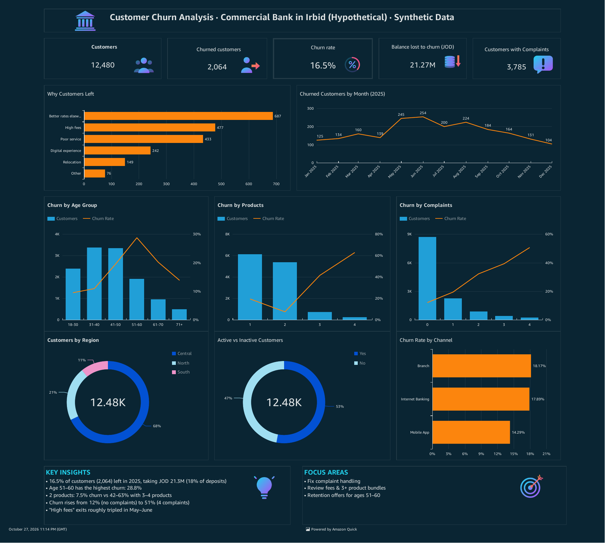
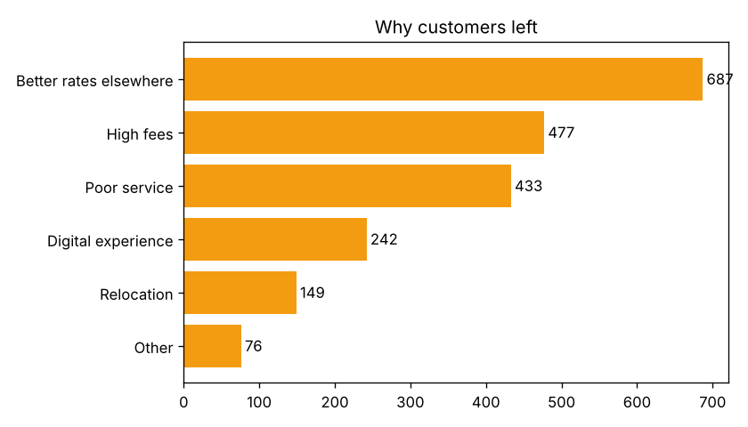
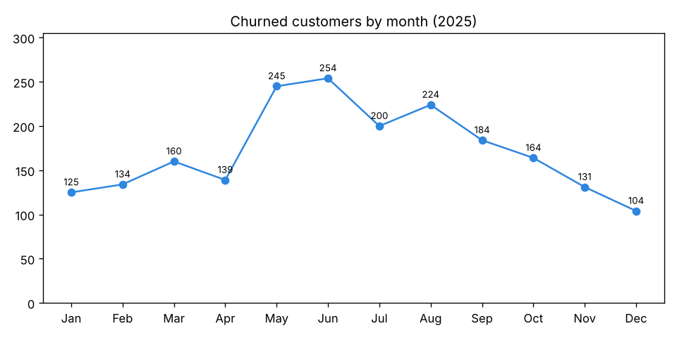
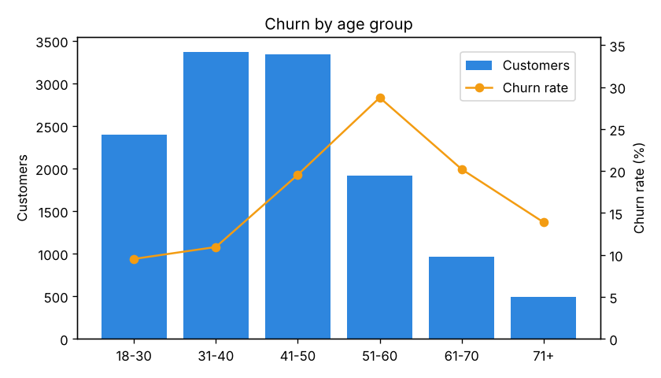
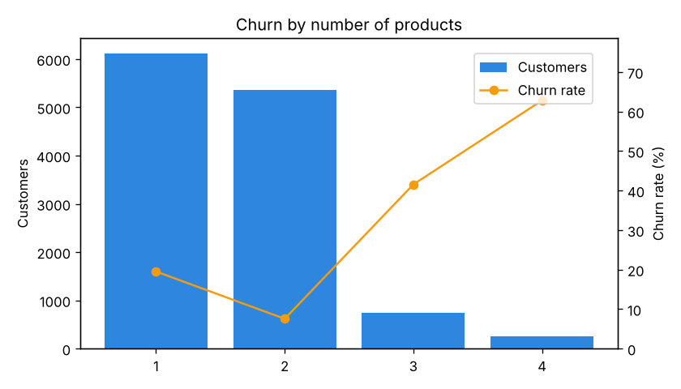
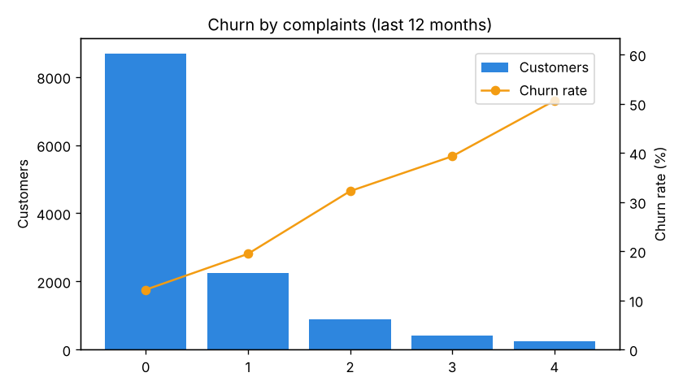

# 🏦 Bank Customer Churn Analysis

An end-to-end data analytics project on a **fictional Jordanian commercial bank**: cleaning raw customer data, building analysis groups, measuring customer churn in 2025, and presenting the results in an interactive dashboard.

> ⚠️ **All data in this project is synthetic.** The bank and its 12,507 customers are fictional and were generated for practice.



---

## 🎯 Business Questions

1. How many customers left the bank in 2025, and how much money left with them?
2. Which customers are most likely to leave (age, products, complaints, activity, region, channel)?
3. Why did customers leave, and when did churn peak?
4. What should the bank focus on to keep its customers?

## 🛠️ Tools

| Step | Tool |
|---|---|
| Data cleaning and calculated fields | **ACL Analytics** (ACLScript) |
| Data storage and publishing | **Diligent One Results** |
| Dashboard | **Diligent One Activity Center** (Amazon QuickSight) |
| Reproducible analysis and charts | **Python** (pandas, matplotlib) |

## 🔄 Workflow

1. **Import** the raw CSV file (12,507 records).
2. **Validate and clean** the data with data quality checks.
3. **Add calculated fields:** age group, credit score group and balance group.
4. **Export** the clean table to Diligent One Results.
5. **Build the dashboard** in Activity Center with KPIs, charts, and calculated fields such as churn rate and balance lost.
6. **Reproduce** the cleaning and KPIs in Python so anyone can run the analysis.

## 🧹 Data Quality Checks

| # | Check | Records |
|---|---|---|
| | Raw file | 12,507 |
| 1 | Duplicate customer records removed | −12 |
| 2 | Invalid age (under 18 or over 100) | −6 |
| 3 | Missing credit score | −5 |
| 4 | Churn date before join date | −4 |
| | **Clean records** | **12,480** |

## 📊 Key KPIs

| KPI | Value |
|---|---|
| Customers | 12,480 |
| Churned customers (2025) | 2,064 |
| Churn rate | **16.5%** |
| Balance lost to churn | **JOD 21.27M** (18.5% of all deposits) |
| Customers with complaints | 3,785 |
| Avg satisfaction: churned vs retained | 3.25 vs 3.67 |

## 💡 Key Insights

- **Age:** customers aged **51–60** have the highest churn rate (**28.8%**), compared with 9.5% for ages 18–30.
- **Products:** customers with **2 products** churn the least (**7.5%**), while those with **3–4 products** churn at **41.5%–62.8%**.
- **Complaints:** churn rises from **12.2%** with no complaints to **50.6%** with 4 complaints.
- **Activity:** inactive customers churn at **21.4%**, compared with **12.2%** for active customers.
- **Region:** the **South** region has the highest churn rate (**22.3%**).
- **Channel:** Branch users churn more (**18.2%**) than Mobile App users (**14.3%**).
- **Reasons:** the top exit reasons are **better rates elsewhere (33%)**, **high fees (23%)** and **poor service (21%)**. "High fees" exits roughly **tripled in May–June**.

## ✅ Recommendations

1. **Fix complaint handling:** customers with complaints are far more likely to leave.
2. **Review fees and 3+ product bundles:** they are linked to the highest churn.
3. **Create retention offers for customers aged 51–60.**
4. **Re-engage inactive customers**, for example through mobile app campaigns.

## 📈 Python Charts

<p>
  
  
</p>
<p>
  
  
</p>
<p>
  
</p>

## 🚀 How to Run

```bash
pip install -r requirements.txt
python src/churn_analysis.py
```

The script cleans the raw file, prints the record reconciliation and KPIs, and saves:
- `data/bank_churn_clean.csv`: the clean table with the calculated groups
- `outputs/`: KPI and churn summary tables
- `images/`: the charts

## 📁 Project Structure

```
bank-customer-churn-analysis/
├── acl/
│   └── data_cleaning.aclscript    # ACL cleaning steps and calculated fields
├── dashboard/
│   ├── churn_dashboard.png        # Activity Center dashboard
│   └── churn_dashboard.pdf
├── data/
│   ├── bank_churn_customers.csv   # raw synthetic data
│   └── bank_churn_clean.csv       # clean data (output)
├── images/                        # Python charts
├── outputs/                       # KPI and summary tables
├── src/
│   └── churn_analysis.py
├── requirements.txt
└── README.md
```

## 📋 Data Dictionary

| Column | Description |
|---|---|
| CustomerID | Unique customer number |
| Gender, Age | Customer gender and age |
| City, Region | Home branch city and region (Central / North / South) |
| Segment | Mass / Affluent / Premium |
| JoinDate, TenureYears | Date the customer joined and years with the bank |
| CreditScore | Credit score (350–850) |
| Balance_JOD, MonthlySalary_JOD | Deposit balance and monthly salary in JOD |
| NumProducts | Number of bank products (1–4) |
| HasCreditCard, IsActiveMember | Yes / No |
| PreferredChannel | Mobile App / Internet Banking / Branch |
| Complaints_12M | Complaints in the last 12 months |
| SatisfactionScore | Latest survey score (1–5) |
| Churned, ChurnStatus | 1 = left in 2025 / 0 = retained |
| ChurnDate, ChurnReason | When and why the customer left |

## 👨‍💻 Author

**Mohammad Almistarehi**: Data Analyst
- GitHub: [Mohammad-Almistarehi](https://github.com/Mohammad-Almistarehi)
- LinkedIn: [mohammad-almistarehi](https://linkedin.com/in/mohammad-almistarehi-190627325)
